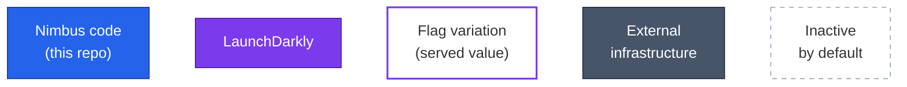
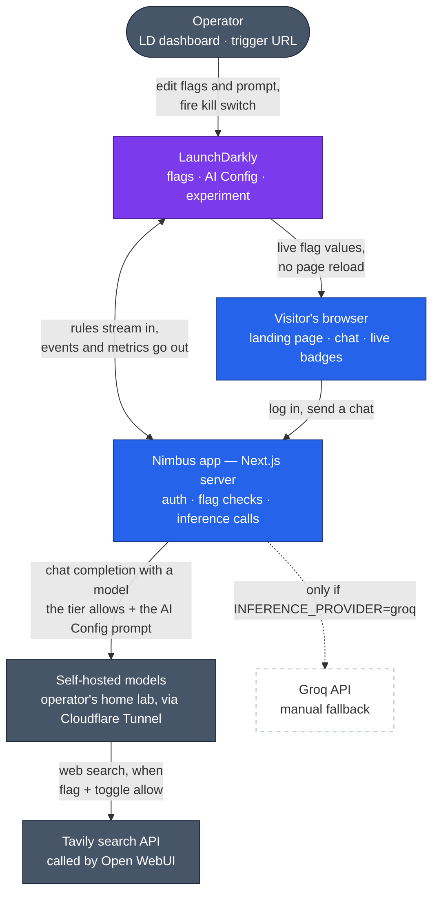
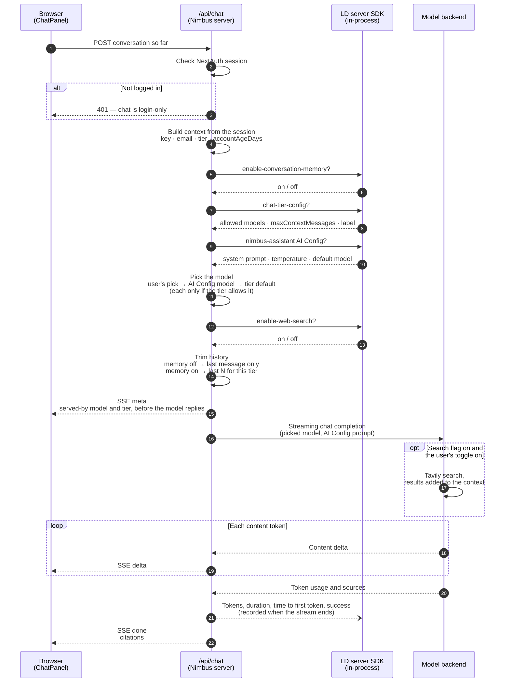
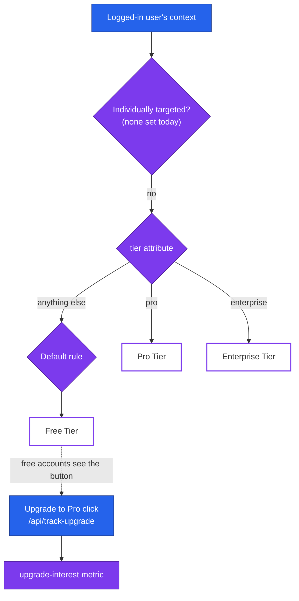
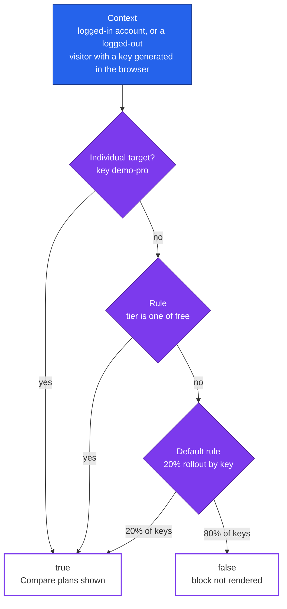
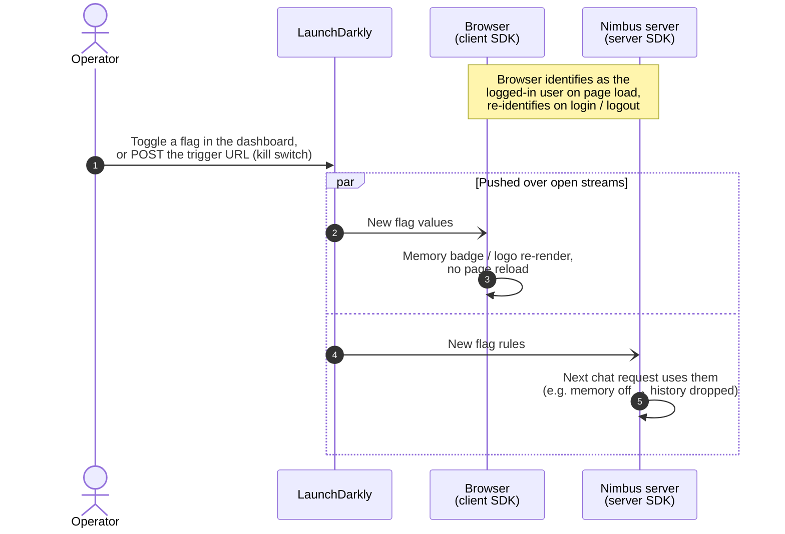

# Architecture & Decisions

Status snapshot as of this document: **release/remediate, targeting,
experimentation, AI Configs, per-tier model menus, and flag-gated web search
are complete.**
Flag-gated image generation is implemented and a live call returned a PNG.
When the toggle is on, that turn's prompt goes to Open WebUI's image API,
which paints it with ComfyUI and stores the file. Nimbus downloads that
file and shows it in the thread.
The app runs in two places on purpose: **self-hosted via Docker alongside the
model backend**, where everything works, and **Vercel**
([nimbus-ai-sample.vercel.app](https://nimbus-ai-sample.vercel.app/)), where
everything except chat works. Both read the same LaunchDarkly environment, so
one dashboard change moves both. See "Deployments" below for why the split
exists.
Third-party integrations are not yet built. This file exists so the build
can be picked back up or handed off without re-deriving the reasoning
behind it.

## What this app is

**Nimbus** is a self-contained demo project: a small SaaS-style landing page
for a tiered AI chat product (Free / Pro / Enterprise). It is not a real
product — there's no billing, no real user database, no production traffic.
The point of the project is to explore how LaunchDarkly's feature-flag,
targeting, and experimentation tools fit into a real tiered-SaaS pattern,
using tiered model/context access as the running example, since that's a
genuine, common way teams use feature management — not a toy scenario.

Three design constraints have shaped every decision below:
1. **Zero ongoing cost** — the operator didn't want to pay to run this.
2. **No security regression** — nothing here should weaken the operator's
   existing home-lab security posture (see "Cloudflare isolation" below).
3. **A stranger can run it** — anyone should be able to clone the repo and
   get the app running without needing the operator's own infrastructure,
   even though the *deployed* instance depends on it (see "Known gaps").

## Status

| Feature | Status | Flag(s) |
|---|---|---|
| Release & remediate (toggle a feature live, roll it back via a trigger) | ✅ Done, tested | `enable-conversation-memory` |
| Targeting (individual target, `tier` rule and percentage rollout on one component) | ✅ Built — the landing page's "Compare plans" block reaches `demo-pro` by individual target, free accounts by rule, and a share of logged-out visitors by rollout. `chat-tier-config` resolves each account to its own plan by rule, and two flags additionally gate the shared `demo-free` login | `show-plan-comparison`, `chat-tier-config`, `enable-conversation-memory`, `enable-image-generation` |
| Experimentation (metric + experiment on the targeting flag) | ⏳ Running since 2026-10-29 on `show-plan-comparison`'s free-tier rule (Compare plans shown vs not); synthetic traffic sent, readout pending. The earlier `chat-tier-config` experiment's result and decision are recorded below | `show-plan-comparison` + `upgrade-interest` metric (`clicked-upgrade` event) |
| AI Configs (managed prompt, parameters and default model) | ✅ Done, tested | `nimbus-assistant` (AgentControl config, separate from the flags above) |
| AI Config experiment (prompt variants; 👍 / 👎, LLM judge, token and latency on Monitoring) | ⏳ Running since 2026-10-29 on `nimbus-assistant`'s default rule (current prompt vs `structured-concise`, 50/50): per-reply feedback through signed resumption tokens, and a judge at 10% on both arms. Synthetic traffic sent, readout pending | `nimbus-assistant` + `nimbus-judge-helpfulness` (judge mode) |
| Model menu per tier (selectable + greyed-out upsell models) | ✅ Done, tested live for each tier, including refused requests for locked models | `chat-tier-config` + `nimbus-assistant` default |
| Web search (Open WebUI + Tavily), all tiers | ✅ Done, tested | `enable-web-search` |
| Image generation | ✅ Done. Prompt routes to Open WebUI's image API; a live call returned a PNG in about 50s. On for every account except `demo-free`, individually gated off to keep the GPU's most expensive operation away from the most widely shared login | `enable-image-generation` |
| Third-party integrations | ⏳ Parked, lowest priority — see "Known gaps" | — |
| Self-hosted deployment (Docker, beside Open WebUI) | ✅ Full functionality — the one to demo from | — |
| Vercel deployment | ⚠️ Everything but chat; Cloudflare challenges its requests to the backend. Kept as deploy proof. See "Deployments" | — |
| README setup instructions | ✅ Done | — |

## Architecture

Five small diagrams, each answering one question, instead of one diagram
that tries to show everything. Start with the big picture; the other four
zoom into one flow each.

**Legend** (used in every flowchart below):

### 1. The big picture — who talks to whom

Two LaunchDarkly SDKs are deliberately both in play, with different jobs:

- **Server SDK (inside the Nimbus app)** makes every decision that matters
  for security or cost — which model to call, how much history to send, which
  prompt to use. It keeps a streamed copy of the flag rules in memory and
  evaluates them locally, so a chat request never waits on a round trip to
  LaunchDarkly; analytics events and AI metrics are sent back in batches.
- **Client SDK (in the browser)** only drives display: the live "Memory:
  On/Off" badge, the logo swap, whether the web search and image toggles
  are offered, and the model menu. It identifies as the same logged-in user
  the server evaluates for, but nothing it says is trusted for access
  decisions — the server re-checks everything itself.

The model backend is a manual switch, not a failover: self-hosted by
default, Groq only when `INFERENCE_PROVIDER=groq` is set explicitly.

### 2. What happens when you send a chat message

A chat reply is a server-sent event stream. The route writes `meta` (the
served-by model, and whether this turn searched) before the model produces a
token, then a `delta` for each token, then `done` with citations. That first
event is what keeps a proxy from closing the request. Its read timeout is
the gap since the last byte from the app, 125 seconds by default, and a long
answer can take longer than that to finish. While the model is quiet, during
a load or a reasoning stretch, the route writes an
SSE comment at least every 20 seconds. The upstream call is aborted at 7
minutes. Token usage, duration, time to first token, and success are
recorded on the AI Config tracker when the stream ends.

Image generation streams too, with the same keepalives, and ends in a single
`image` or `error` event. It used to return one JSON body, which sent nothing
until the picture was ready; once a request ran past the proxy's 125 seconds,
Cloudflare closed it first, and the browser showed "the chat backend is
unreachable" in place of the upstream's actual error. Only refusals made before
any work starts (401, 400, the message allowance's 403) are still plain JSON.

Every LaunchDarkly answer above comes from the SDK's in-memory copy of the
rules, built from the session — never from anything the browser sends. The
browser's model pick is only a request, checked against the tier's list.
Two systems, two jobs: `chat-tier-config` decides *which models and how
much history* a tier is allowed (access control), while the
`nimbus-assistant` AI Config decides *how the assistant talks* and which
allowed model is the default — see "Key decisions" below.

### 3. How `chat-tier-config` picks a tier — targeting

Each outlined box is one of the flag's JSON variations,
`{ label, maxContextMessages, defaultModel, models, lockedModels }`. As of
2026-10-27 each demo account resolves to its own plan — verified by a
read-only evaluation (`sendEvents: false`, so no exposures were recorded):

| Account | Reason | Variation | Models | `maxContextMessages` |
|---|---|---|---|---|
| `demo-free` | `FALLTHROUGH` | Free Tier | 4B | 4 (never reached — see below) |
| `demo-pro` | `RULE_MATCH` (rule 0) | Pro Tier | 4B, 4B-128k | 20 |
| `demo-enterprise` | `RULE_MATCH` (rule 1) | Enterprise Tier | all four | 50 |

LaunchDarkly still checks individual targets before rules; there simply are
none set now. The default rule is also the slot an experiment attaches to,
which is why the free tier is the only one an experiment on this flag can
reach — `demo-pro` and `demo-enterprise` match a rule first and never enter
one.

**Two limits that are easy to confuse.** `maxContextMessages` is a sliding
window: `/api/chat` only applies it when `enable-conversation-memory` is on
for that context, and it never refuses anything — it just stops replaying
older turns. Free is excluded from memory, so the free tier is stateless and
its `4` is never exercised.

`maxMessagesPerConversation` is the hard stop, added on 2026-10-28 because
the window was being read as a quota it never was. It is unconditional, it is
checked before any work is done on the request, and the browser blocks the
composer at the same boundary so the user isn't typing into a request that
will be refused. The comparison lives in one shared helper
(`overMessageLimit` in `lib/tier-config.ts`) because the two sides ask
subtly different questions: the route counts a history that already contains
the pending message, while the browser asks about the message not yet
written, and splitting that logic is how the wall ends up a message apart on
the two sides.

### 4. How `show-plan-comparison` reaches each audience — targeting a component

This is the flag the targeting demo is built on, because it uses all three
ways of choosing who gets a component, in the order a team would release
one carefully: one named account first (`demo-pro`, by individual target),
then the audience it is for (free accounts, by a rule on `tier`), then a
measured share of everyone else (the default rule's percentage rollout).
Each demo login shows a different evaluation reason for the same flag.

The rollout is only meaningful because each logged-out browser is its own
context. The client SDK generates and stores a key per browser (see the
context note under "Flag and AI Config inventory"); with one shared key,
every visitor would land in the same bucket and the 20% would be all or
nothing.

Logged-out visitors are evaluated only in the browser, since the server
never sees their key. For a logged-in account the page evaluates the flag
server-side for the first paint and the client SDK takes over from there,
so the block appears or disappears live when targeting changes.

### 5. Live changes without a redeploy — release and remediate

The same path covers editing the AI Config's prompt or temperature: the
next chat reply reflects it, with no redeploy.

### Where each piece lives

| Piece | File(s) |
|---|---|
| Landing page, header, badges | `app/page.tsx`, `components/BrandLogo.tsx`, `components/MemoryStatusBadge.tsx` |
| "Compare plans" block (targeting demo) | `components/PlanComparison.tsx`, first paint in `app/page.tsx` |
| Chat UI, model menu | `components/ChatPanel.tsx` |
| Tier config shape, validation, model choice | `lib/tier-config.ts` |
| Client SDK setup + user identify | `components/LDClientProvider.tsx`, `components/LDUserSync.tsx`, `app/layout.tsx` |
| Login (3 static demo accounts) | `app/login/page.tsx`, `lib/auth.ts`, `lib/demo-users.ts` |
| Chat request handling | `app/api/chat/route.ts` |
| Server SDK + context builder | `lib/ld-server.ts` |
| Fallback values if LD is unreachable | `lib/tier-config.ts`, `lib/ai-config.ts` |
| Server-side first render of the model menu | `app/page.tsx` |
| Model backend switch (self-hosted / Groq) | `lib/inference.ts` |
| Upgrade click → conversion metric | `components/UpgradeCta.tsx`, `app/api/track-upgrade/route.ts` |
| Reply feedback (👍 / 👎) | `components/ChatPanel.tsx`, `app/api/feedback/route.ts`, `lib/feedback-token.ts` |
| LLM judge on sampled replies | `lib/judge.ts`, called from `app/api/chat/route.ts` |
| Synthetic experiment traffic | `scripts/simulate-experiment.ts` (Compare plans), `scripts/simulate-ai-experiment.ts` (prompt) |
| Self-hosted deployment | `Dockerfile`, `docker-compose.yml`, `next.config.ts` |

The home-lab side of the model backend (Cloudflare Tunnel → Access with a
Service-Auth-only policy → Open WebUI's API → llama.cpp router serving
`Qwen3.5-4B`, `Qwen3.5-4B-128k`, `Qwen3-Coder-30B-A3B-Instruct-UD-Q4_K_XL` and
`Qwen3.8-27B-UD-Q3_K_XL`) is deliberately kept out of the diagrams; why it's
shaped that way is covered under "Cloudflare isolation" below. The router
keeps one model loaded at a time on a single GPU, so the first reply after
switching models waits for a reload (about 17s for Coder-30B and 29s for
Qwen 3.8 in testing); the chat says so instead of just "Thinking…".

## Deployments

Two of them, serving different purposes.

**Self-hosted (Docker, on the same host as Open WebUI) — the working one.**
The app reaches Open WebUI at its internal address (`http://open-webui:8080/api`
over a shared Docker network), so the inference call never leaves the host.
No Cloudflare hop, no Access service token — `CF_ACCESS_*` are blank here,
and `lib/inference.ts` already only attaches those headers when they're set.
Only the app itself is published, via a tunnel ingress rule on its own
hostname (`proj-nimbus.<domain>`, served over plain HTTP on loopback since
TLS terminates at Cloudflare's edge). Chat, web search, and image generation
all work.

That public hostname has a **Cloudflare Access application** in front of it,
but configured as a geographic filter rather than an identity gate: a single
Bypass policy scoped by country, so requests from the permitted region reach
the app without an Access login prompt and everything else is refused at the
edge. The landing page is therefore public; the chat is not. Authentication
is the app's own — `/api/chat` checks the session and returns `401` — which
is the arrangement the rest of this document assumes, and the reason that
check lives in the route rather than in the UI.

Worth recording because an earlier configuration got this wrong: when the
same hostname was fronted by an Access policy that *required* authentication,
Access intercepted every path including `/api/chat`. An expired Access session
then returned its HTML login page where the browser expected JSON,
`response.json()` threw, and the UI reported the generic "chat backend is
unreachable" error — a login lapse wearing the costume of an outage. That is
the same shape as the problem described under "Cloudflare isolation" below.
A Bypass policy avoids it, since there is no Access session to expire; an
identity policy on a hostname serving a JSON API reintroduces it.

**Vercel — everything except chat.** Every request from Vercel's serverless
functions to the public backend hostname comes back `403` with Cloudflare's
"Just a moment..." interstitial: a bot challenge fired at the edge, before
the request reached the Access Service Auth policy or Open WebUI. Confirmed
Vercel-specific by isolating the variable — identical requests from local dev,
same credentials, succeed. The clean fix is a Cloudflare Configuration Rule
skipping the challenge for just that hostname, but the Rules engine is gated
behind a paid plan on this zone. The only free lever is a zone-wide toggle,
which would also drop bot protection from the main Open WebUI hostname — a
real regression against constraint #2 above, to unblock a demo. An IP
allowlist isn't an option either: Vercel doesn't give Hobby/Pro tiers a
static outbound IP.

The Vercel instance is kept rather than deleted because it still demonstrates
something true: the app builds and deploys cleanly to a standard platform,
and the flag-driven UI (logo swap, live Memory badge, login gating) works
there. Only the hop to private infrastructure is blocked, for an external,
documented reason.

**Both point at the same LaunchDarkly environment.** A flag toggled in the
dashboard, or the remediation trigger fired, moves both at once. A second LD
environment would isolate them, but everything behavioral in LaunchDarkly is
per-environment — targeting rules, individual targets, the experiment, the AI
Config's targeting, and the trigger URL would all need rebuilding — so one
shared environment is the deliberate choice.

Self-hosting changes two platform assumptions the Vercel path baked in:

- **`AUTH_TRUST_HOST=true` is required.** Auth.js v5 only infers the host
  automatically when it detects Vercel's `VERCEL` variable; behind a tunnel it
  has to be told, or logins fail at the callback.
- **`NEXT_PUBLIC_LAUNCHDARKLY_CLIENT_ID` is a build-time value.** It's inlined
  into the browser bundle by `next build`, so the Dockerfile takes it as a
  build arg. Supplied only at run time, `components/LDClientProvider.tsx`
  falls through to rendering without `LDProvider` — and its warning is gated
  behind `NODE_ENV !== 'production'`, so a production container would show no
  error at all while client-side flags silently stopped working.

`lib/inference.ts` picks its image-generation timeout off the same `VERCEL`
variable: 55s there to stay under the Hobby plan's 60s function cap, 240s
self-hosted where no such cap exists and ComfyUI may need a cold start.

## Key decisions

**Fresh project instead of an existing one.** Building a small app from
scratch avoided forcing a LaunchDarkly demo into an existing project it
didn't fit.

**Local-hosted models as the primary backend, Groq as a manual fallback only.**
The operator already runs a llama.cpp router with four usable models (listed
under "Where each piece lives" above) — using them costs nothing and maps
naturally onto Free/Pro/Enterprise, each tier adding models to the one below
it. Groq's
code path (`lib/inference.ts`) is fully implemented but never exercised by
default, and is switched on only via `INFERENCE_PROVIDER=groq` — deliberately
not an automatic failover, so a background process (like the eventual
experiment traffic simulator) can never silently incur real charges.

**Cloudflare isolation: a dedicated hostname, not a shared one.** The first
attempt added a path-scoped (`/api/*`) Access application on the operator's
*existing* Open WebUI hostname. That broke the live app: Access issues a
session per Application (keyed by its own AUD), so the browser's session for
the root app didn't satisfy the new one, and Open WebUI's own background
`fetch()` calls to `/api/*` got silently redirected to a login page instead of
JSON — a reload loop. The fix was a **second, fully separate hostname**
(`nimbus-api.<domain>`) on the same tunnel, pointed at the same origin, with
its own Access application carrying exactly one policy: **Service Auth**, no
human login path at all. This also respects a standing rule for the
backend — never tunnel llama.cpp's port directly — since this still only
ever reaches it through Open WebUI's API.

That dedicated hostname existed so an *externally hosted* app could reach the
backend. Now that the working deployment runs on the same host and talks to
Open WebUI internally, the hostname is only load-bearing for the Vercel
instance — which is precisely the path Cloudflare blocks (see "Deployments").
It's kept because the Vercel deployment is kept, but the primary deployment no
longer depends on it. The "never tunnel llama.cpp directly" rule still holds:
the internal call goes to Open WebUI's API, just over the Docker network
rather than through the tunnel.

**No database.** Three static demo accounts (`lib/demo-users.ts`) sharing one
password from `DEMO_PASSWORD` (bcrypt-compared), NextAuth (Auth.js v5)
Credentials provider, JWT sessions carrying
`tier` and `accountAgeDays`. A real user table would be pure overhead for a
demo whose entire job is to show LaunchDarkly concepts — the static list still
gives real per-account identity for context attributes and individual
targeting.

**The chat is gated behind login.** Originally built open, then deliberately
locked down: an ungated chat box on a publicly deployed app is an open
invitation to flood a home GPU with anonymous requests. `/api/chat` checks
the session itself and returns `401` — enforcement lives server-side, not in
whether the UI happens to show a button. The demo logins used to be printed
on the login page and in the README; both were removed, and the shared
password moved out of the source into `DEMO_PASSWORD` in `.env.local`, which
is never committed. A login gate whose password is public in the repo gates
nothing.

This matters more, not less, now that the self-hosted instance is publicly
reachable and its Cloudflare Access application is configured as a regional
filter rather than an identity gate (see "Deployments" above). The landing
page is deliberately open — someone should be able to see what this is
without credentials — while every path that reaches a model is gated in the
route itself. A gate that lives in the UI would be no gate at all here.

**Individual targeting is downgrade-only, not an upgrade — and is no longer
standing.** The first version targeted `demo-free` → Enterprise Tier as a
"surprise upgrade" story. That was wrong: the `demo-free` login was printed on
the public login page at the time, so it would have handed out unlimited free
access to the most expensive model to anyone who found the repo — and even
with the logins now private, a widely shared demo account is the wrong one to
grant extra access to. It was replaced by `demo-pro` → Free Tier ("stepped
down for exceeding fair use"), which proved the precedence without granting
anyone extra access.

That target was **removed on 2026-10-27**. It worked as a mechanism and
failed as a demo: a Pro account served the Free config contradicted the
account badge, the model menu (which offered to upgrade a Pro user *to Pro*),
and the reply caption all at once, and it collided with the experiment then
running on the default rule, which was handing the free account the Pro
config at the same time. The two together read as the tiers being swapped.
The downgrade-only principle still holds for any future target; precedence is
now demonstrated live instead — adding the target in front of an audience
collapses the open tab's model menu with no reload, which shows both
individual-target precedence and streaming updates in one move.

**The message allowance is per conversation, because there is no database.**
A free plan that stops at N messages is the limit that makes the Upgrade
button mean something — it fires at the moment someone hits a wall, instead
of being a button with no occasion to press it. But a real per-account quota
needs somewhere to keep the count, and this project deliberately has no
persistence (see "Known gaps"). The count is therefore taken from the history
the browser submits on each request, which makes it a per-conversation limit:
reloading starts a fresh allowance. That is an honest product shape rather
than a workaround — "4 messages per conversation on the free plan" is
something a real SaaS sells — but it is not an account quota and the docs say
so rather than implying otherwise. The enforcement itself is real: the route
refuses with 403 regardless of what the browser does, so the wall cannot be
clicked past.

It also fails open. `DEFAULT_TIER_CONFIG` carries no limit, so an unreachable
LaunchDarkly gives people a few extra messages rather than turning them away
on a value that could not be read — the opposite choice from `memoryEnabled`,
which defaults to `false`, because withholding a feature is a smaller harm
than refusing to answer at all.

**Only the free plan is capped, deliberately.** Pro and Enterprise omit
`maxMessagesPerConversation` and are unlimited. The wall is the upsell, so a
plan you upgrade *to* must not have one, or upgrading doesn't resolve what
drove the click. The UI enforces that shape: the wall only carries the
Upgrade button for accounts that have somewhere to go, so a capped paid plan
would strand a paying user at a dead end with nothing to click. Reusing the
tiers' `maxContextMessages` values (20 and 50) for the quota would also put
two different limits behind the same numbers in the same variation, which is
precisely the confusion that prompted building this. If paid plans ever do
need fair-use caps, pick numbers that are visibly quotas rather than borrowed
context windows, and leave the top tier uncapped.

**AI Config and chat-tier-config are two systems with two different jobs, not
one duplicated.** `chat-tier-config` stays the access-control layer — which
models and context length an account's *tier* is allowed, plus which
higher-tier models it sees greyed out. The `nimbus-assistant` AI Config
(LaunchDarkly's AgentControl product; the SDK still calls it
`LDAIConfig`/`completionConfig`) controls the assistant's system prompt and
`temperature` for every account, and its `model` is the default pick. The
two can't fight over the backend because of a fixed order in
`lib/tier-config.ts#resolveModel`: the user's menu pick, then the AI
Config's model, then the tier's `defaultModel` — and each one is used only
if it's in the tier's `models` list. Changing the AI Config's model to
Qwen 3.8 therefore moves Enterprise's default without a redeploy, while Free
and Pro keep the 4B their plan allows. One trade-off: the AI Config tracker
reports token usage under the config's variation, so replies from a model
the user picked are counted there too. Worth being explicit about what LaunchDarkly's AI Config
actually is here: it does not host or run any model — it only serves
*configuration* (prompt text, parameters) the same way a regular flag serves
a value. The real inference call, and whatever credentials it requires, is
still entirely on this app's own code (`lib/inference.ts`), unchanged by
adding this.

**Avoided LaunchDarkly's official OpenAI provider package.**
`@launchdarkly/server-sdk-ai-openai` would have been the "blessed" way to
auto-invoke a model from an AI Config, but it pins `openai@>=4 <7` while this
app already runs `openai@7`. Downgrading a working dependency just to use an
optional convenience wrapper wasn't worth it. Instead, `app/api/chat/route.ts`
calls `aiClient.completionConfig()` for the prompt/parameters, keeps calling
the existing `chatCompletion()` for the model request, and records token
usage, duration, time to first token, and success on the AI Config tracker
when that stream ends — same outcome, zero new dependency conflicts.

**The live environment's credentials stay out of the repo.** The README has
two paths: a short quick start for someone who already has a configured
`.env.local`, and full from-scratch instructions for setting up your own
LaunchDarkly environment and model backend. The configured environment and
the backend credentials are never published.

## Flag and AI Config inventory

| Key | Type | Client-side? | Purpose |
|---|---|---|---|
| `sanity-check` | boolean | yes | Early connectivity check only; removed from code once real flags landed. Safe to delete from the dashboard. |
| `enable-conversation-memory` | boolean | yes (needs the live badge) | Release & remediate demo, and a paid-plan entitlement. Gates whether `/api/chat` forwards conversation history or treats every message as stateless. Has a Generic trigger wired to turn it off, for the remediation demo. Serves `true` by default, with `demo-free` served `false` so memory reads as a paid feature. The exclusion is currently an **individual target on the `demo-free` key**, so it gates that one account; a second free account would still get memory. Unlike the image-generation gate, which is per-account by intent, this one is described as a plan boundary — a `tier is one of free` rule would make it one. |
| `new-logo` | boolean | yes (needs the live swap) | On, serving `true` to every account (verified 2026-10-29). Gates the redesigned cloud + wordmark logo (`components/Logo.tsx`) vs. the original plain text wordmark, via `components/BrandLogo.tsx`. A second, independent example of the release/remediate pattern — applied to a brand/visual rollout instead of a product feature, which is a genuinely common real-world use of flags. Defaults to the new logo if the flag is missing. |
| `show-plan-comparison` | boolean | yes (required: logged-out visitors are evaluated only in the browser) | The targeting demo. Gates the landing page's "Compare plans" block (`components/PlanComparison.tsx`). Individual target `demo-pro` → `true`; rule `tier is one of free` → `true`; default rule a 20% / 80% percentage rollout by `key`, which is what reaches logged-out visitors. Off by default if the flag is missing, as for any unreleased component. The plan copy in the block is marketing text, not entitlements — `chat-tier-config` and the feature flags decide those per request. |
| `enable-web-search` | boolean | yes (shows/hides the toggle live) | Pure kill switch — no rules, no targets, so Off removes it for every account at once. `/api/chat` only adds Open WebUI's `features.web_search` when this flag is on for the context, the user's toggle asked for it, and the provider is local — the browser can request search but never force it. Serves `true` to all three accounts (verified); a `tier` rule would make it an entitlement in a live product, but it is deliberately not one here. |
| `enable-image-generation` | boolean | yes (shows/hides the toggle live) | Kill switch for image generation, and a paid-plan entitlement. When the flag is on, the user's toggle is on, and the provider is local, `/api/chat` sends that turn's prompt to Open WebUI `POST /api/v1/images/generations` instead of the chat model. The returned file is fetched server-side and shown in the thread. Serves `true` by default, with an individual target on the `demo-free` key serving `false`. That is deliberately per-account rather than a `tier` rule: image generation is the most expensive thing the single GPU can be asked to do, and `demo-free` is the login that gets shared most widely. Editing a previous image is not wired yet. |
| `chat-tier-config` | JSON (4 variations; three in use: `free` / `pro` / `enterprise`) | yes (the model menu and the message allowance update live; the server re-checks every request) | Targeting demo, and the carrier for every per-plan limit. Each variation is `{ label, maxContextMessages, maxMessagesPerConversation?, defaultModel, models, lockedModels }`: Free selects the 4B; Pro the 4B and the 4B long-context; Enterprise those plus Coder-30B and Qwen 3.8-27B. `lockedModels` are shown disabled with the plan that unlocks them and are never accepted by `/api/chat`. Malformed or older single-model values fall back safely (`normalizeTierConfig`). Optional `maxMessagesPerConversation` is the plan's hard message allowance (see "Two limits that are easy to confuse"); omitting it means unlimited, which is what Pro and Enterprise do. Rule-based on the context's `tier` attribute, with no individual targets as of 2026-10-27; the Default rule serves Free Tier and is the slot an experiment attaches to. A fourth variation, `Enterprise Tier - No 27B`, exists in the environment but is served by nothing. |

Context sent to LaunchDarkly: `{ kind: "user", key: <demo account id>, email,
tier, accountAgeDays }`, built in `lib/ld-server.ts#buildUserContext` from the
NextAuth session — never from client input. The browser's client SDK is given
the same server-built context, so live badges evaluate for the same user the
server does. Logged-out visitors are an anonymous context with no key of its
own: the client SDK generates a random key per browser and keeps it in
localStorage, so each visitor is a separate context and a percentage rollout
on the landing page splits them instead of bucketing everyone together. With
storage blocked, the SDK generates a fresh key on every page load. Only `key` and `tier` are matched
on today: `accountAgeDays` is sent so a second attribute is there to target
on, but no rule uses it. It is kept as a ready-made extension — a loyalty
rule such as `accountAgeDays` ≥ 365 → Pro Tier, which would promote
`demo-pro` (420 days) and `demo-enterprise` (1,100) but not `demo-free` (12).

**Experiment, now:** `Compare Plans - Upgrade` has run on
`show-plan-comparison`'s free-tier rule (Rule 1) since 2026-10-29. Control
is `false` (no block), treatment `true`, 50 / 50, with 100% of free contexts
in the experiment; primary metric `upgrade-interest`; frequentist with
sequential testing, significance 0.05, two-sided. It is the upsell-varying
design described below, run on the flag Part 2's targeting now lives on, so
targeting and experiment share one flag as intended. Both arms get the
genuine free product and the Upgrade button, and differ only in whether
they see the plan comparison. It runs on the rule rather than the default
rule because the default rule's audience (logged-out and Enterprise
visitors) never sees an Upgrade button. While it runs, `demo-free` is
bucketed into control and does not see the block. 4,000 synthetic
free-tier sessions were sent on 2026-10-29 (`npm run simulate:experiment`,
4% vs 7% click rates); the readout is pending.

**Experiment, earlier:** `Upgrade Click` ran on `chat-tier-config`'s
Default rule — Free Tier (control) vs. Pro Tier, 50/50, among contexts that
reach that rule (i.e. `tier` isn't `pro` or `enterprise`). Enterprise Tier was
explicitly excluded from the experiment's variation set entirely (not just
weighted low) — an earlier pass defaulted to a 3-way split across all of the
flag's variations, which would have randomly routed a slice of free-tier
traffic to the most expensive model.

**Iteration 2 was stopped on 2026-10-27, for design, not for a result.** Its
treatment arm served free accounts the Pro config, so a free account held the
long-context model while still being shown "Upgrade to Pro" — the button is
gated on the session's `tier` ([app/page.tsx](../app/page.tsx)), not on the
served variation. That is correct experiment design (hide the upsell in the
treatment arm and it can never convert, which would measure nothing), but
combined with the `demo-pro` downgrade then in place it made the two accounts
look swapped, and the tier story unreadable. LaunchDarkly will again record a
"shipped variation" for the iteration; as with Iteration 1, that reflects the
stop, not an outcome.

**A design that doesn't fight the tiers:** vary the *upsell* rather than the
entitlement — a variation identical to Free Tier but with `lockedModels: []`,
run against Free Tier. Both arms then receive the genuine free product and
differ only in whether the account can see what its plan excludes, so the
Upgrade button stays honest in both. The experiment now running applies the
same idea to the "Compare plans" block on `show-plan-comparison` instead of
a fourth `chat-tier-config` variation. Primary metric: `upgrade-interest`, built on the `clicked-upgrade` event (Count/average-per-user).
That is not a conversion rate for real users. Each Upgrade button fires once
and then shows a thank-you note, but the state lives in the component: a
reload brings the button back, and reaching the message wall shows a second,
fresh one. One account can therefore send the event several times, and a
count metric weighs a repeat clicker above someone who clicked once.
Iteration 1's readout is unaffected, because the simulator sends at most one
event per context. Before running an experiment on real traffic, switch the
metric to measure **occurrence** (did the context click at all) rather than
count. `scripts/simulate-experiment.ts` generates
synthetic free-tier sessions against it — real LD exposures and events, but
documented as synthetic data since the app has no production audience.

**Experiment result and decision (Iteration 1, Oct 3–5 2026).**
Hypothesis: if free-tier users get the Pro models and context window, they
click Upgrade more often, because the better experience raises perceived
value. LaunchDarkly ran it as a frequentist A/B test with sequential testing,
two-sided, significance level 0.05, on the `upgrade-interest` metric (event
`clicked-upgrade`).

| | Free Tier (control) | Pro Tier |
|---|---|---|
| Exposures | ~2,000 (50%) | ~2,000 (50%) |
| Relative difference in upgrade clicks | — | **+202.86%** |
| 95% confidence interval | — | +130.30% to +275.43% |

4,001 contexts in total. The interval is entirely above zero, so Pro Tier is
significantly better in the desired direction — LaunchDarkly's own takeaway
says the same. The simulator was built with a 4% vs 11% click rate (+175%),
which falls inside the interval, so the readout matches what went in.

**Decision:** give free-tier users the Pro experience on the default rule.
Because the data is synthetic, this shows how the decision would be made,
not proof that real users behave this way; with real traffic the same
readout is the trigger to ship. LaunchDarkly records Iteration 1's "shipped
variation" as Free Tier only because the iteration was stopped to change
the variation format for the model menu, not as an outcome. Iteration 2
runs on the new format.

**AI Config:** `nimbus-assistant`, an AgentControl config in Completion mode
(not a flag, but evaluated the same way via `aiClient.completionConfig()`).
One variation: a custom-registered model entry (`Qwen3.5-4B (Self Hosted)`,
$0 token costs — accurate, since it's self-hosted) with a `temperature`
parameter, plus a system-message prompt. The prompt, temperature and model
are re-fetched from LaunchDarkly on every chat request; the prompt and
temperature go straight into the inference call, and the model becomes the
default pick for tiers that allow it — confirmed live by editing the prompt in the
dashboard mid-session and watching the very next response change tone with
no redeploy. The route records token usage, success, duration, and time to
first token on `aiConfig.createTracker()` when the reply stream ends.

**AI Config experiment: prompt variants, judged two ways.** Hypothesis: a
tighter, structured system prompt (`structured-concise`: answer in the first
sentence, at most three bullets, clarify only when genuinely ambiguous) gets
more replies rated helpful *and* produces fewer output tokens. Only the
prompt differs between arms; model and temperature are held equal, so a
difference is attributable to the prompt. The audience is everyone who
chats (the config's default rule), randomized by user.

Quality is the experiment's question; cost and latency are watched beside
it, because on a single home GPU they are the same resource: every output
token is time someone waits and capacity nobody else gets. They are left out
of the experiment's metrics to keep the readout to two, and read per
variation on the AI Config's Monitoring tab instead.

| Metric | Source | Role |
|---|---|---|
| Positive feedback (`$ld:ai:feedback:user:positive`) | 👍 / 👎 under each reply | Primary |
| Judge score (the judge config's metric key) | `nimbus-judge-helpfulness` on a sample of replies | Secondary: quality signal with far more coverage than voluntary ratings |
| Output tokens, time to first token, errors | The tracker, on every reply | Not experiment metrics; compared per variation on Monitoring. A "better" prompt that is slower or costlier is not a win here |

Three decisions behind it:

- **Feedback reaches the exact run, through a signed resumption token.**
  Feedback arrives in a later request than the reply. Re-evaluating the
  config at that point would credit the variation the user is in *now*,
  which is wrong after any edit or iteration change. The SDK's tracker
  instead exposes a resumption token naming its run, variation and version,
  and `aiClient.createTracker(token)` rebuilds that tracker. The chat route
  sends the token with the reply's `done` event and `/api/feedback` turns it
  back into the tracker. The token is only base64, so a browser could
  rewrite it to credit the other arm; `lib/feedback-token.ts` signs it with
  `AUTH_SECRET`, bound to the account it was issued to, and the feedback
  route refuses anything else. The context still comes from the session.
- **The judge is configured in LaunchDarkly and run on this app's
  inference.** Each variation's judge configuration (attached judges and
  their sampling rate) comes through `completionConfig()`, and the judge
  itself is an AI Config in judge mode with its own rubric and
  temperature. Its model field is ignored: the judge form only lists hosted
  providers, which this app never calls. The
  SDK's `Judge` class needs a Runner; LaunchDarkly's provider packages pin
  an older `openai` than this app (the same conflict as above), so
  `lib/judge.ts` supplies a one-method Runner over `chatCompletion()`. The
  score is recorded with `trackJudgeResult()` on the reply's own tracker,
  so it lands on the same variation as the reply's tokens and feedback. The
  judge sees the user and assistant turns, not the system prompt, since the
  system prompt is the thing that differs between arms.
- **The judge never forces a model swap.** It runs on the variation's own
  model, and only when that model wrote the reply (not a model the user
  picked instead), after the reply is delivered, on the
  variation's sampling rate (10% here). The home lab keeps one model loaded
  at a time; judging a Coder-30B reply on the 4B would unload the model the
  user is mid-conversation with. It also keeps every score from one judge
  model. Replies from other models are simply not judged, which affects
  both arms alike.

Volume comes from `scripts/simulate-ai-experiment.ts`, which calls no
model: it records made-up tokens, latency, feedback and judge scores on real
trackers, through the same SDK calls the app makes, and is documented as
synthetic. Real chats on the self-hosted deployment, real ratings included,
feed the same experiment.

## Known gaps (intentional, not forgotten)

- **The message allowance resets on reload.** It is counted from the
  submitted conversation, so it is per conversation and not per account; a
  new tab gets a fresh allowance. Making it an account quota means adding
  storage, which is the same gap as conversation persistence below.
- **Chat can't work on the Vercel deployment** — the cause is external and
  documented under "Deployments" above. Not fixable in this repo.
- **Citations depend on undocumented Open WebUI behavior.** Searched replies
  read Open WebUI's top-level `sources` field (not part of the OpenAI schema)
  and rebuild its numbering — unique URL, in order — to make each `[n]` a
  link. If a future Open WebUI version changes that field or its numbering,
  markers would be dropped rather than mislinked. Tavily also often returns
  section front pages (e.g. `reuters.com/technology`) rather than articles,
  so some citations link to a site section, not the exact story.
- **Image generation needs two extra API paths.** Endpoint restrictions stay on. The allowlist is `/api/chat/completions`, `/api/v1/models`, `/api/v1/images/generations`, and `/api/v1/files`. The last two are what let Nimbus ask for a picture and download the stored PNG. A direct call with the prompt "a single red circle on a white background" returned a PNG data URL in about 50 seconds.
- **Groq path is implemented but untested.** It type-checks and follows the
  same interface as the local path, but no live request has gone through it,
  and the flag's model IDs would need swapping for Groq ones (see the README).
- **AI metrics are attributed to the AI Config's model.** When a user picks
  a different model from the menu, its token usage is still reported under
  `nimbus-assistant`'s variation. In the prompt experiment this affects both
  arms equally, since assignment is random, but it widens the token spread.
- **Feedback is one per reply in the UI, not on the server.** The buttons
  lock after one rating, but a signed token can be posted again by hand, and
  each post records again. Making a rating single-use needs storage for spent
  tokens, the same gap as the message allowance.
- **The judge's output format is asked for, not enforced.** The SDK's judge
  expects structured output; this backend is a plain chat endpoint, so the
  JSON shape is requested in the prompt and parsed leniently. A reply it
  can't read is logged and dropped, never guessed into a score.
- **A judged reply holds the GPU briefly.** The judge runs after the reply
  is delivered, but a message sent in the next few seconds queues behind it.
  The sampling rate is the control for this.
- **Integrations parked, not abandoned.** Researched
  GitHub Code References as the best fit — it would link each flag/config
  key directly to the exact lines using it in this repo. Found a real
  constraint before building anything: LaunchDarkly's dashboard-integrated
  Code References panel is gated to paid plans ("contact Sales to upgrade"),
  which a trial account won't have. Their docs point to a lighter-weight
  alternative for Developer/Foundation-tier accounts — a GitHub Action
  ("Flag Code References in Pull Request") that comments directly on a PR's
  diff instead of writing into LD's paid dashboard feature. That alternative
  wasn't evaluated in depth before pausing this. Revisit if the LaunchDarkly
  plan on the account changes, or if the PR-comment variant turns out to work
  on the current plan — worth a quick check before writing it off entirely.
