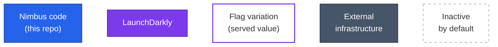
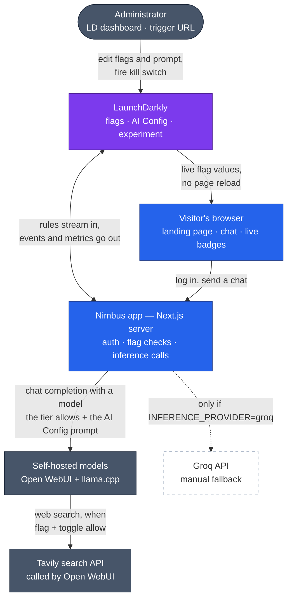
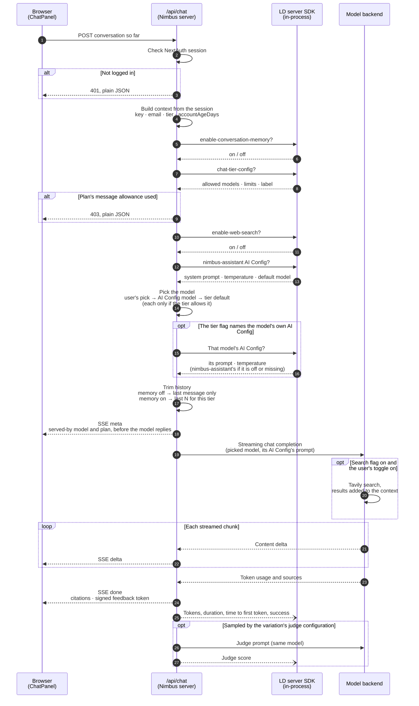
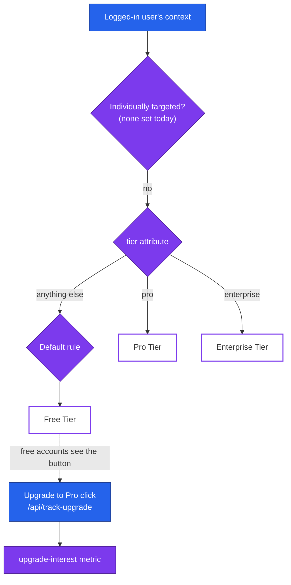
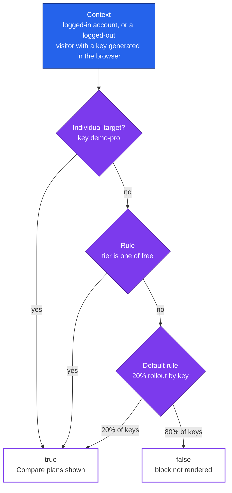
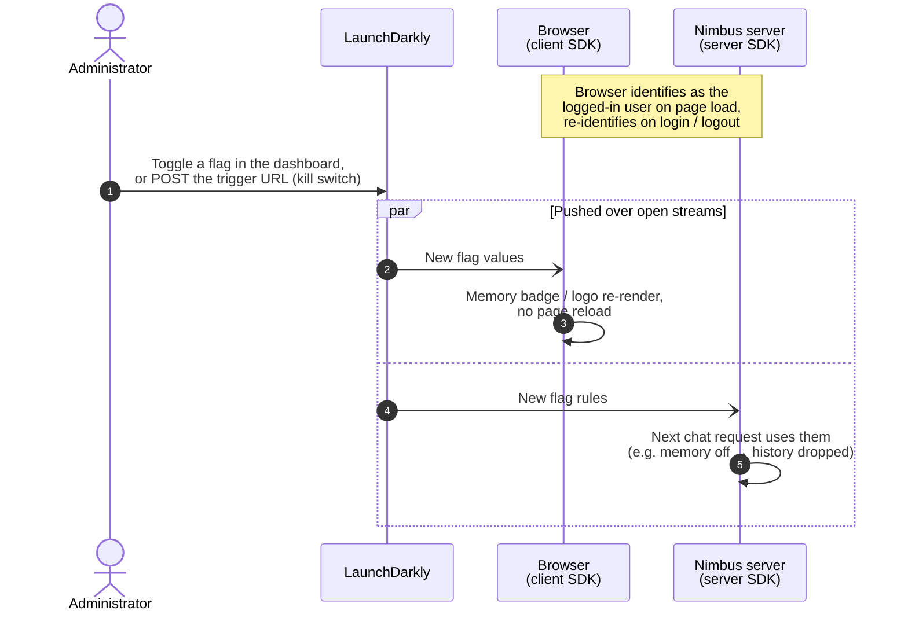

# Architecture & Decisions

How Nimbus is built, why it is built that way, what its experiments found,
and what it deliberately leaves out. The README covers setup; this file
covers reasoning.

Everything in the status table below works on the **self-hosted Docker
deployment**, beside the model backend. The **Vercel** deployment
([nimbus-ai-sample.vercel.app](https://nimbus-ai-sample.vercel.app/)) runs
everything except chat. Both read the same LaunchDarkly environment; see
"Deployments" for why there are two.

## What this app is

**Nimbus** is a demo project: a small SaaS-style landing page for a tiered AI
chat product (Free / Pro / Enterprise), with no billing, no user database and
no production traffic. It uses tiered model and context access as the running
example for LaunchDarkly's feature flags, targeting, experimentation and AI
Configs, since plan-based access is a common use of feature management.

Three constraints shaped the decisions below:
1. **No ongoing cost** to run it.
2. **No weakening of the model backend's existing security** (see
   "Cloudflare isolation" below).
3. **Anyone can run it** from the repo with their own LaunchDarkly account
   and backend, even though the deployed instance uses a specific
   self-hosted backend.

## Status

| Feature | Status | Flag(s) |
|---|---|---|
| Release & remediate (toggle a feature live, roll it back via a trigger) | ✅ Done, tested | `enable-conversation-memory` |
| Targeting (individual target, `tier` rule and percentage rollout on one component) | ✅ Built — the landing page's "Compare plans" block reaches `demo-pro` by individual target, free accounts by rule, and a share of logged-out visitors by rollout. `chat-tier-config` resolves each account to its own plan by rule, and two flags additionally gate the shared `demo-free` login | `show-plan-comparison`, `chat-tier-config`, `enable-conversation-memory`, `enable-image-generation` |
| Experimentation (metric + experiment on the targeting flag) | ✅ Concluded 2026-10-29 on `show-plan-comparison`'s free-tier rule: showing Compare plans raised upgrade interest by +72.48% (95% CI +30.41% to +114.54%) on synthetic traffic; `true` shipped. The earlier `chat-tier-config` experiment's result and decision are recorded below too | `show-plan-comparison` + `upgrade-interest` metric (`clicked-upgrade` event) |
| AI Configs (managed prompt, parameters and default model) | ✅ Done, tested | `nimbus-assistant` (AI Config, separate from the flags above) |
| AI Config experiment (prompt variants; 👍 / 👎, LLM judge, token and latency on Monitoring) | ⏳ Running (Iteration 3) on `nimbus-assistant`'s default rule, current prompt vs `structured-concise`, 50/50; per-reply feedback through signed resumption tokens, a judge at 10% on both arms. On synthetic traffic the judge reads +11.76% (significant) and the primary, 👍 count, +10.31% (not yet significant): not shipped, kept running. Readout below | `nimbus-assistant` + `nimbus-judge-helpfulness` (judge mode) |
| Model menu per tier (selectable + greyed-out upsell models) | ✅ Done, tested live for each tier, including refused requests for locked models | `chat-tier-config` + `nimbus-assistant` default |
| Web search (Open WebUI + Tavily), all tiers | ✅ Done, tested | `enable-web-search` |
| Image generation | ✅ Done. The prompt goes to Open WebUI's image API, about 50 s per image. On for every account except `demo-free`, individually gated off to keep the GPU's most expensive operation away from the most widely shared login | `enable-image-generation` |
| Third-party integrations | ⏳ Parked, lowest priority — see "Known gaps" | — |
| Self-hosted deployment (Docker, beside Open WebUI) | ✅ Full functionality — the one to demo from | — |
| Vercel deployment | ⚠️ Everything but chat; Cloudflare challenges its requests to the backend. Kept as deploy proof. See "Deployments" | — |
| README setup instructions | ✅ Done | — |

## Architecture

Five small diagrams, each answering one question, instead of one diagram
that tries to show everything. Start with the big picture; the other four
zoom into one flow each.

**Legend** (used in every flowchart below):

### 1. The big picture — who talks to whom

Two LaunchDarkly SDKs are in play, with different jobs:

- **Server SDK (inside the Nimbus app)** makes every decision that matters
  for security or cost — which model to call, how much history to send, which
  prompt to use. It keeps a streamed copy of the flag rules in memory and
  evaluates them locally, so a chat request never waits on a round trip to
  LaunchDarkly; analytics events and AI metrics are sent back in batches.
- **Client SDK (in the browser)** only drives display: the live "Memory:
  On/Off" badge, the logo swap, whether the web search and image toggles
  are offered, and the model menu. It identifies as the same logged-in user
  the server evaluates for, but nothing it says is trusted for access
  decisions — the server re-checks everything itself.

The model backend is a manual switch, not a failover: self-hosted by
default, Groq only when `INFERENCE_PROVIDER=groq` is set explicitly.

### 2. What happens when you send a chat message

A chat reply is a server-sent event stream. The route writes `meta` (the
served-by model and plan, and whether this turn searched) before the model
produces anything, then a `delta` per streamed chunk, then `done` with
citations and the reply's signed feedback token. The first event keeps a
proxy from closing the request: its read timeout (125 seconds by default)
counts from the last byte, and while the model is quiet, during a load or
a reasoning stretch, the route writes an SSE comment at least every 20
seconds. The upstream call is aborted at 7 minutes. When the stream ends the
route records token usage, duration, time to first token and success on the
AI Config tracker, then runs any sampled judge (see the AI Config experiment
below).

Image generation streams the same way, with the same keepalives, and ends
in a single `image` or `error` event, so a slow image still reports its real
error instead of a proxy timeout. Only refusals made before any work starts
(401, 400, the message allowance's 403) are plain JSON.

Every LaunchDarkly answer above comes from the SDK's in-memory copy of the
rules, built from the session — never from anything the browser sends. The
browser's model pick is only a request, checked against the tier's list.
Two systems, two jobs: `chat-tier-config` decides *which models and how
much history* a tier is allowed (access control), while the
`nimbus-assistant` AI Config decides *how the assistant talks* and which
allowed model is the default — see "Key decisions" below.

### 3. How `chat-tier-config` picks a tier — targeting

Each outlined box is one of the flag's JSON variations,
`{ label, maxContextMessages, defaultModel, models, lockedModels }`. As of
2026-10-27 each demo account resolves to its own plan — verified by a
read-only evaluation (`sendEvents: false`, so no exposures were recorded):

| Account | Reason | Variation | Models | `maxContextMessages` |
|---|---|---|---|---|
| `demo-free` | `FALLTHROUGH` | Free Tier | 4B | 4 (never reached — see below) |
| `demo-pro` | `RULE_MATCH` (rule 0) | Pro Tier | 4B, 4B-128k | 20 |
| `demo-enterprise` | `RULE_MATCH` (rule 1) | Enterprise Tier | all four | 50 |

LaunchDarkly checks individual targets before rules; this flag has none.
An experiment can be attached to any of these rules or to
the default rule; none runs on this flag today.

**Two limits that are easy to confuse.** `maxContextMessages` is a sliding
window: `/api/chat` only applies it when `enable-conversation-memory` is on
for that context, and it never refuses anything — it just stops replaying
older turns. Free is excluded from memory, so the free tier is stateless and
its `4` is never exercised.

`maxMessagesPerConversation` is the hard stop. It is unconditional, it is
checked before any work is done on the request, and the browser blocks the
composer at the same boundary so the user isn't typing into a request that
will be refused. The comparison lives in one shared helper
(`overMessageLimit` in `lib/tier-config.ts`) because the two sides ask
subtly different questions: the route counts a history that already contains
the pending message, while the browser asks about the message not yet
written, and splitting that logic is how the wall ends up a message apart on
the two sides.

### 4. How `show-plan-comparison` reaches each audience — targeting a component

This is the flag the targeting example is built on, because it uses all three
ways of choosing who gets a component, in the order a team would release
one carefully: one named account first (`demo-pro`, by individual target),
then the audience it is for (free accounts, by a rule on `tier`), then a
measured share of everyone else (the default rule's percentage rollout).
Each demo login shows a different evaluation reason for the same flag.

The rollout is only meaningful because each logged-out browser is its own
context. The client SDK generates and stores a key per browser (see the
context note under "Flag and AI Config inventory"); with one shared key,
every visitor would land in the same bucket and the 20% would be all or
nothing.

Logged-out visitors are evaluated only in the browser, since the server
never sees their key. For a logged-in account the page evaluates the flag
server-side for the first paint and the client SDK takes over from there,
so the block appears or disappears live when targeting changes.

### 5. Live changes without a redeploy — release and remediate

The same path covers editing the AI Config's prompt or temperature: the
next chat reply reflects it, with no redeploy. While an experiment runs on
the config, its variations are locked and can't be edited.

### Where each piece lives

| Piece | File(s) |
|---|---|
| Landing page, header, badges | `app/page.tsx`, `components/BrandLogo.tsx`, `components/MemoryStatusBadge.tsx` |
| "Compare plans" block (targeting demo) | `components/PlanComparison.tsx`, first paint in `app/page.tsx` |
| Chat UI, model menu | `components/ChatPanel.tsx` |
| Tier config shape, validation, model choice | `lib/tier-config.ts` (which AI Config a model uses: `lib/ai-config.ts`) |
| Client SDK setup + user identify | `components/LDClientProvider.tsx`, `components/LDUserSync.tsx`, `app/layout.tsx` |
| Login (3 static demo accounts) | `app/login/page.tsx`, `lib/auth.ts`, `lib/demo-users.ts` |
| Chat request handling | `app/api/chat/route.ts` |
| Server SDK + context builder | `lib/ld-server.ts` |
| Fallback values if LD is unreachable | `lib/tier-config.ts`, `lib/ai-config.ts` |
| Server-side first render of the model menu | `app/page.tsx` |
| Model backend switch (self-hosted / Groq) | `lib/inference.ts` |
| Upgrade click → conversion metric | `components/UpgradeCta.tsx`, `app/api/track-upgrade/route.ts` |
| Reply feedback (👍 / 👎) | `components/ChatPanel.tsx`, `app/api/feedback/route.ts`, `lib/feedback-token.ts` |
| LLM judge on sampled replies | `lib/judge.ts`, called from `app/api/chat/route.ts` |
| Synthetic experiment traffic | `scripts/simulate-experiment.ts` (Compare plans), `scripts/simulate-ai-experiment.ts` (prompt) |
| Self-hosted deployment | `Dockerfile`, `docker-compose.yml`, `next.config.ts` |
| Stream event types and parser | `lib/chat-stream.ts` |

The model backend behind `LOCAL_AI_BASE_URL` is Open WebUI's API in front
of a llama.cpp router serving `Qwen3.5-4B`, `Qwen3.5-4B-128k`,
`Qwen3-Coder-30B-A3B-Instruct-UD-Q4_K_XL` and `Qwen3.8-27B-UD-Q3_K_XL`.
It is kept out of the diagrams; "Cloudflare isolation" below covers how it
is reached. It loads one model at a time on a single GPU (see the README's
assumptions for load times).

## Deployments

**Self-hosted (Docker, on the same host as Open WebUI): the working one.**
The app reaches Open WebUI at its internal address (`http://open-webui:8080/api`
over a shared Docker network), so the inference call never leaves the host
and needs no Cloudflare Access token (`CF_ACCESS_*` are blank, and
`lib/inference.ts` only sends those headers when both are set). Only the app
is published, through a tunnel public hostname over plain HTTP on loopback,
with TLS at Cloudflare. Chat, web search and image generation all work. The
README's Docker section lists the build-time and proxy settings this needs.

That hostname has a **Cloudflare Access application** configured as a
geographic filter rather than an identity gate: one Bypass policy scoped by
country, so permitted regions reach the app with no Access login and the
rest are refused at the edge. The landing page is public; authentication for
the chat is the app's own, with `/api/chat` returning `401` without a
session. An Access policy that *requires* login would not work here: Access
intercepts every path, so an expired Access session returns its HTML login
page where the browser expects JSON from `/api/chat`, and the UI reports
"the chat backend is unreachable". A Bypass policy has no session to expire.

**Vercel: everything except chat.** Requests from Vercel's functions to the
backend's public hostname get `403` with Cloudflare's "Just a moment..."
bot challenge, before they reach the Access Service Auth policy or Open
WebUI. Identical requests from elsewhere, with the same credentials,
succeed. Skipping the challenge for one hostname needs a Configuration Rule,
which is a paid feature on this zone; the free alternative is a zone-wide
toggle that would also remove bot protection from the main Open WebUI
hostname, against constraint #2. Vercel's Hobby and Pro tiers have no
static outbound IP to allowlist. The instance is kept because it shows the
app deploys cleanly to a standard platform, and its flag-driven UI works.
`lib/inference.ts` reads Vercel's `VERCEL` variable to cap image requests at
55 s there (the Hobby plan's limit is 60 s) and 240 s self-hosted.

**Both point at the same LaunchDarkly environment**, so a flag change or the
remediation trigger moves both at once. A second environment would isolate
them, but targeting, individual targets, experiments, the AI Config's
targeting and the trigger URL are all per environment and would need
rebuilding, so one shared environment is used.

## Key decisions

**A new project rather than an existing one.** A small app built for the
purpose fits LaunchDarkly's concepts without working around an unrelated
codebase.

**Self-hosted models as the primary backend, Groq as a manual fallback.**
The self-hosted llama.cpp router already serves four models (listed under
"Where each piece lives"), costs nothing to use, and maps onto
Free / Pro / Enterprise, each tier adding models to the one below. Groq's
code path (`lib/inference.ts`) is implemented and switched on only by
`INFERENCE_PROVIDER=groq`. It is not an automatic failover, so nothing,
including the traffic simulators, can incur Groq charges without that
setting.

**Cloudflare isolation: a dedicated hostname, not a shared one.** A
path-scoped (`/api/*`) Access application on the existing Open WebUI
hostname does not work: Access issues a session per application, so Open
WebUI's own `fetch()` calls to `/api/*` were redirected to a login page
instead of returning JSON. The backend is therefore reached on a **separate
hostname** on the same tunnel, whose Access application has exactly one
policy, **Service Auth**, with no human login path. Either way the app only
reaches llama.cpp through Open WebUI's API, never its port directly. Since
the self-hosted deployment talks to Open WebUI internally, that hostname is
only used by the Vercel instance.

**No database.** Three static demo accounts (`lib/demo-users.ts`) share one
password from `DEMO_PASSWORD` (bcrypt-compared), through the Auth.js v5
Credentials provider, with JWT sessions carrying `tier` and `accountAgeDays`.
A user table would add nothing to what the project shows; the static list
still gives each account a real identity for context attributes and
individual targeting.

**The chat is gated behind login.** An open chat box on a public deployment
would let anyone send requests to the GPU. `/api/chat` checks the session
itself and returns `401`, so enforcement is server-side rather than in the
UI. The demo logins are not printed on the login page or in the README, and
the shared password lives in `DEMO_PASSWORD` in `.env.local`, which is never
committed. The landing page stays public, so visitors can see what the app
is without credentials.

**Individual targets only ever restrict.** A widely shared demo account is
the wrong one to grant extra access to, so an individual target here only
takes something away: `demo-free` loses memory and image generation, and the
`demo-pro` target on `show-plan-comparison` releases a component early
rather than unlocking a plan. No individual target sits on
`chat-tier-config`, because serving one account another plan's config
contradicts its account badge, model menu and reply caption at once.

**The message allowance is per conversation, fails open, and caps only the
free plan.** A free plan that stops at N messages gives the Upgrade button a
moment to appear. A per-account quota needs storage, and this project has
none, so the count is taken from the history the browser submits: reloading
starts a fresh allowance ("4 messages per conversation on the free plan").
The route still refuses with 403 whatever the browser does. It fails open:
`DEFAULT_TIER_CONFIG` carries no limit, so an unreachable LaunchDarkly never
blocks a reply. Memory does the opposite and defaults to off, since
withholding a feature is a smaller failure than refusing to answer. Pro and
Enterprise omit the field and are unlimited: the limit is the upsell, so
the plan you upgrade to has none, and the notice only shows the Upgrade
button to accounts that have somewhere to go. If paid plans ever need
fair-use caps, use numbers distinct from their `maxContextMessages` values
(20 and 50) so the two limits aren't confused.

**The AI Config and `chat-tier-config` do different jobs.**
`chat-tier-config` is access control: which models and how much history an
account's tier is allowed, and which higher-tier models it sees greyed out.
The `nimbus-assistant` AI Config sets the assistant's system prompt and
`temperature` for every account, and its `model` is the default pick. They
can't conflict because `resolveModel` in `lib/tier-config.ts` applies a
fixed order: the user's menu pick, then the AI Config's model, then the
tier's `defaultModel`, each used only if it is in the tier's `models` list.
Changing the AI Config's model to Qwen 3.8 therefore moves Enterprise's
default without a redeploy, while Free and Pro keep the 4B. A model entry in
`chat-tier-config` can also name its own AI Config (`aiConfigKey`); that
model then takes its prompt, temperature and tracker from that config, so its
feedback and judge scores are reported per model, while `nimbus-assistant`
still picks the default. Which configs exist is a dashboard change, not a
deploy (`aiConfigForModel` in `lib/ai-config.ts`). The AI Config
serves configuration only, the way a flag serves a value; it hosts no model,
and the inference call and its credentials stay in `lib/inference.ts`.

**LaunchDarkly's provider packages are not used.** The SDK can invoke a
model, or a judge, through `@launchdarkly/server-sdk-ai-openai` and related
packages, but they pin `openai@>=4 <7` and this app runs `openai@7`. The
chat route calls `completionConfig()` for the prompt and parameters, keeps
its own `chatCompletion()` for the model request, and records the run's
metrics on the AI Config tracker; `lib/judge.ts` gives the SDK's `Judge` a
one-method Runner over the same `chatCompletion()`. Because the packages
are absent, the SDK logs a warning on every lookup of a judged variation;
`lib/ld-logger.ts` drops only those warnings.

**The live environment's credentials stay out of the repo.** The README has
a quick start for someone who already has a configured `.env.local`, and
from-scratch steps for setting up your own LaunchDarkly environment and
model backend.

## Flag and AI Config inventory

| Key | Type | Client-side? | Purpose |
|---|---|---|---|
| `sanity-check` | boolean | yes | Early connectivity check; no longer read by the code. Safe to delete from the dashboard. |
| `enable-conversation-memory` | boolean | yes (the live badge) | Release and remediate. Gates whether `/api/chat` forwards conversation history or answers every message on its own. A Generic trigger turns it off for the remediation demo. Serves `true` by default; an **individual target on `demo-free`** serves `false`, so only that account loses memory and a new free account would keep it. A `tier is one of free` rule would make memory a plan feature instead. |
| `new-logo` | boolean | yes (the live swap) | On, serving `true` to every account. Gates the cloud + wordmark logo (`components/Logo.tsx`) against the plain text wordmark, via `components/BrandLogo.tsx`: release and remediate applied to a visual change. Shows the new logo if the flag is missing. |
| `show-plan-comparison` | boolean | yes (required: logged-out visitors are evaluated only in the browser) | The targeting example. Gates the landing page's "Compare plans" block (`components/PlanComparison.tsx`). Individual target `demo-pro` → `true`; rule `tier is one of free` → `true`; default rule a 20% / 80% rollout by `key`, which is what reaches logged-out visitors. Off if the flag is missing. The block's plan copy is marketing text; `chat-tier-config` and the feature flags decide entitlements per request. |
| `enable-web-search` | boolean | yes (shows/hides the toggle) | Kill switch with no rules or targets, so Off removes search for every account at once. `/api/chat` adds Open WebUI's `features.web_search` only when the flag is on for the context, the user's toggle asked for it, and the provider is local, so the browser can request search but never force it. |
| `enable-image-generation` | boolean | yes (shows/hides the toggle) | Kill switch for image generation. When the flag and the user's toggle are on and the provider is local, `/api/chat` sends that turn's prompt to Open WebUI's `POST /api/v1/images/generations` instead of the chat model, fetches the stored file server-side and shows it in the thread. Serves `true` by default, with an individual target on `demo-free` serving `false`: per account by design, to keep the GPU's most expensive operation away from the most widely shared login, not a plan feature. |
| `chat-tier-config` | JSON (4 variations; three in use) | yes (the model menu and message allowance update live; the server re-checks every request) | Every per-plan limit. Each variation is `{ label, maxContextMessages, maxMessagesPerConversation?, defaultModel, models, lockedModels }`, and each `models` entry `{ id, label, slow?, aiConfigKey? }`: Free selects the 4B; Pro the 4B and the long-context 4B; Enterprise those plus Coder-30B and Qwen 3.8-27B. Every model but the 4B names its own AI Config with `aiConfigKey`; the 4B uses `nimbus-assistant`. `lockedModels` are shown disabled with the plan that unlocks them and are never accepted by `/api/chat`. Malformed values fall back field by field (`normalizeTierConfig`), and a variation without a usable `models` list falls back to the Free config. Rules on `tier` serve Pro and Enterprise; the default rule serves Free; no individual targets. A fourth variation, `Enterprise Tier - No 27B`, is served by nothing. |
| `nimbus-assistant` | AI Config (completion) | n/a (server only) | The assistant's system prompt, temperature and default model for every model without an `aiConfigKey`, and the prompt experiment's two variations. |
| `nimbus-assistant-4b-128k` | AI Config (completion) | n/a (server only) | Qwen3.5-4B-128k's own prompt and temperature, and where its feedback and tokens land. Named by `aiConfigKey` in Pro and both Enterprise variations. No judges. |
| `qwen3-coder-30b-a3b-instruct-ud-q4-k-xl` | AI Config (completion) | n/a (server only) | The same for Coder-30B, named in both Enterprise variations. No judges. |
| `qwen3.8-27b-ud-q3-k-xl` | AI Config (completion) | n/a (server only) | The same for Qwen 3.8-27B, named in the Enterprise variation. No judges. |
| `nimbus-judge-helpfulness` | AI Config (judge) | n/a (server only) | The helpfulness rubric attached to both `nimbus-assistant` variations at a 10% sampling rate. |

Context sent to LaunchDarkly: `{ kind: "user", key: <demo account id>, email,
tier, accountAgeDays }`, built in `lib/ld-server.ts#buildUserContext` from the
NextAuth session — never from client input. The browser's client SDK is given
the same server-built context, so live badges evaluate for the same user the
server does. Logged-out visitors are an anonymous context with no key of its
own: the client SDK generates a random key per browser and keeps it in
localStorage, so each visitor is a separate context and a percentage rollout
on the landing page splits them instead of bucketing everyone together. With
storage blocked, the SDK generates a fresh key on every page load. Only `key`
and `tier` are matched on: `accountAgeDays` is sent as a second attribute to
target on, for example a loyalty rule such as `accountAgeDays` ≥ 365 → Pro
Tier, which would promote `demo-pro` (420 days) and `demo-enterprise` (1,100)
but not `demo-free` (12).

## Experiments

### Compare plans, on the targeting flag

`Compare Plans - Upgrade` ran on `show-plan-comparison`'s free-tier rule
(Rule 1) on 2026-10-29, so targeting and experiment share one flag. Control
is `false` (no block), treatment `true`, 50 / 50, with 100% of free contexts
in the experiment; frequentist with sequential testing, significance 0.05,
two-sided. Both arms get the same free product and Upgrade button and
differ only in whether they see the plan comparison. It runs on the rule
rather than the default rule because the default rule's audience
(logged-out and Enterprise visitors) never sees an Upgrade button. While it
ran, `demo-free` was bucketed into control and did not see the block.

The primary metric, `upgrade-interest`, counts `clicked-upgrade` events
per user (sent by `/api/track-upgrade`). One account can click more than
once, since a reload brings the button back, so for real traffic the
metric should measure **occurrence** (did the context click at all). The
readout below is unaffected: `scripts/simulate-experiment.ts` sends 4,000
synthetic free-tier sessions with at most one click each (4% vs 7%).

**Experiment result and decision (`Compare Plans - Upgrade`, Iteration 1,
2026-10-29).** Hypothesis: if free users see the plan comparison, more of
them click Upgrade, because they can see what Pro adds.

| | `false`, no block (control) | `true`, block shown |
|---|---|---|
| Exposures | ~2,000 (50%) | ~2,000 (50%) |
| Relative difference in `upgrade-interest` | — | **+72.48%** |
| 95% confidence interval | — | +30.41% to +114.54% |

4,001 contexts over about 12 hours (the 4,000 synthetic sessions plus
`demo-free`). The interval is entirely above zero, so showing the block is
significantly better in the desired direction, and LaunchDarkly's own
takeaway says the same. The simulator was built with a 4% vs 7% click rate
(+75%), which falls inside the interval, so the readout matches what went
in. Sequential testing is what makes it sound to read the result as soon
as it is significant rather than at a fixed sample size.

**Decision:** ship `true` on the free-tier rule, by stopping the iteration
with `true` as the winner, so every free account sees Compare plans,
`demo-free` included. The data is synthetic: this shows how the decision is
made, and with real traffic the same readout would be the trigger to ship.

**An earlier experiment on `chat-tier-config`** (`Upgrade Click`, Oct 3–5)
tested Free Tier against Pro Tier on the default rule and read **+202.86%**
upgrade clicks for Pro (95% CI +130.30% to +275.43%, 4,001 contexts,
simulated at 4% vs 11%). It was replaced because its treatment arm gave
free accounts the Pro entitlement while still showing "Upgrade to Pro",
which made the plans unreadable. Varying only what free users *see*, as
the Compare plans experiment does, keeps the Upgrade button meaningful in
both arms.

### Prompt variants, on the AI Config

`nimbus-assistant` is an AI Config in completion mode, evaluated like a
flag through `aiClient.completionConfig()`. Its variations register a
custom model entry (`Qwen3.5-4B (Self Hosted)`, $0 token cost) with a
`temperature` parameter and a system prompt. The prompt, temperature and
model are fetched on every chat request, and the route records token
usage, success, duration and time to first token on `aiConfig.createTracker()`
when the reply stream ends.

**Hypothesis:** a
tighter, structured system prompt (`structured-concise`: answer in the first
sentence, at most three bullets, clarify only when genuinely ambiguous) gets
more replies rated helpful *and* produces fewer output tokens. Only the
prompt differs between arms; model and temperature are held equal, so a
difference is attributable to the prompt. The audience is everyone who
chats (the config's default rule), randomized by user.

Quality is the experiment's question; cost and latency are watched beside
it, because on a single GPU they are the same resource: every output
token is time someone waits and capacity nobody else gets. They are left out
of the experiment's metrics to keep the readout to two, and read per
variation on the AI Config's Monitoring tab instead.

| Metric | Source | Role |
|---|---|---|
| Positive feedback (`$ld:ai:feedback:user:positive`) | 👍 / 👎 under each reply | Primary |
| Judge score (the judge config's metric key) | `nimbus-judge-helpfulness` on a sample of replies | Secondary: quality signal with far more coverage than voluntary ratings |
| Output tokens, time to first token, errors | The tracker, on every reply | Not experiment metrics; compared per variation on Monitoring. A "better" prompt that is slower or costlier is not a win here |

Three decisions behind it:

- **Feedback reaches the exact run, through a signed resumption token.**
  Feedback arrives in a later request than the reply. Re-evaluating the
  config at that point would credit the variation the user is in *now*,
  which is wrong after any edit or iteration change. The SDK's tracker
  instead exposes a resumption token naming its run, variation and version,
  and `aiClient.createTracker(token)` rebuilds that tracker. The chat route
  sends the token with the reply's `done` event and `/api/feedback` turns it
  back into the tracker. The token is only base64, so a browser could
  rewrite it to credit the other arm; `lib/feedback-token.ts` signs it with
  `AUTH_SECRET`, bound to the account it was issued to, and the feedback
  route refuses anything else. The context still comes from the session.
- **The judge is configured in LaunchDarkly and run on this app's
  inference.** Each variation's judge configuration (attached judges and
  their sampling rate) comes through `completionConfig()`, and the judge
  itself is an AI Config in judge mode with its own rubric and
  temperature. Its model field is ignored: the judge form only lists hosted
  providers, which this app never calls. `lib/judge.ts` runs the SDK's
  `Judge` on this app's own inference (see "LaunchDarkly's provider
  packages are not used" above). The
  score is recorded with `trackJudgeResult()` on the reply's own tracker,
  so it lands on the same variation as the reply's tokens and feedback. The
  judge sees the user and assistant turns, not the system prompt, since the
  system prompt is the thing that differs between arms.
- **The judge never forces a model swap.** It runs on the variation's own
  model, and only when that model wrote the reply (not a model the user
  picked instead; a model with its own AI Config is judged by that config's
  judges, on itself), after the reply is delivered, on the
  variation's sampling rate (10% here). The backend loads one model at a
  time, so judging a Coder-30B reply on the 4B would unload the model the
  user is mid-conversation with. It also keeps every score from one judge
  model. Replies from other models are not judged, which affects both arms
  alike.

Volume comes from `scripts/simulate-ai-experiment.ts`, which calls no
model: it records made-up tokens, latency, feedback and judge scores on real
trackers, through the same SDK calls the app makes. Real chats on the self-hosted deployment, real ratings included,
feed the same experiment.

**Experiment readout (`nimbus-assistant-judge`, Iteration 3, 2026-10-29).**
Frequentist with sequential testing, significance 0.05, two-sided; 4,000
synthetic users, 50 / 50.

| Metric | `structured-concise` vs control | 95% CI | Verdict |
|---|---|---|---|
| Positive feedback count (primary) | +10.31% | −2.36% to +22.97% | Not significant |
| Judge helpfulness (secondary) | **+11.76%** | +7.44% to +16.09% | Significant |

The judge readout matches what went in (mean score 0.74 vs 0.66, +12%). The
primary is under-powered rather than wrong. It counts 👍 per exposed user,
so it moves with how many people rate at all as well as with how they rate:
in this iteration the treatment arm drew fewer raters (687 vs 715), and
👍 per user came out 0.237 vs 0.214, +10.8%, against a built-in effect of
+16.7% (35% rate, 70% vs 60% positive). Iteration 2, on the same synthetic
process, read +19.64% (CI +8.03% to +33.26%). Both intervals contain the
true effect; at 2,000 users per arm, sampling noise alone decides whether
this one clears zero.

**Decision: don't ship yet; keep the iteration running.** The experiment
was designed to be decided on the primary metric, and that metric is
positive but inconclusive. Shipping on a significant secondary while the
primary straddles zero would be choosing the metric after seeing the data.
Everything points the same way, so the next step is more data, not a
different conclusion: sequential testing allows adding users to the running
iteration and reading the result again without inflating the error rate.
Ship `structured-concise` (serve it on the default rule) if the primary
clears zero; if it settles near zero instead, the judge's gain is not one
users notice, and the shorter prompt's case rests on cost alone. For real
traffic, positive *share* of rated replies (the Monitoring tab's
satisfaction rating) would be a sharper primary than 👍 per exposed user,
because it removes the noise of who chooses to rate.

Two setup mistakes were found and fixed on the way:

- **Iteration 1** was stopped before any data: the judge appeared attached
  to `structured-concise` in the editor, but the save had never gone
  through, so that arm was served without a judge configuration. AI Config
  variations are locked while an experiment runs, and the editor keeps
  showing the unsaved edit. Checked by reading the delivered variation
  through the SDK rather than trusting the dashboard.
- **Iteration 2** read +19.64% on feedback but +0.32% (CI −19.73% to
  +20.37%) on the judge. The judge metric was counting every exposed user,
  with a 0 for the ~90% never judged, so both arms averaged about 0.064 and
  it measured how often the judge ran, not how well replies scored. Fixed by
  excluding units that send no event.
- **Iteration 3** is the readout above.

## Known gaps

- **The message allowance resets on reload.** It is counted from the
  submitted conversation, so it is per conversation and not per account; a
  new tab gets a fresh allowance. An account quota needs storage, which the
  app doesn't have; conversations aren't stored either.
- **Chat doesn't work on the Vercel deployment.** The cause is Cloudflare's
  bot challenge, outside this repo; see "Deployments".
- **Citations depend on undocumented Open WebUI behavior.** Searched replies
  read Open WebUI's top-level `sources` field (not part of the OpenAI schema)
  and rebuild its numbering — unique URL, in order — to make each `[n]` a
  link. If a future Open WebUI version changes that field or its numbering,
  markers would be dropped rather than mislinked. Tavily also often returns
  section front pages (e.g. `reuters.com/technology`) rather than articles,
  so some citations link to a site section, not the exact story.
- **Groq path is implemented but untested.** It type-checks and follows the
  same interface as the local path, but no live request has gone through it,
  and the flag's model IDs would need swapping for Groq ones (see the README).
- **Models without their own AI Config share `nimbus-assistant`'s
  metrics.** Their tokens and feedback are reported under its variation and
  its model, because feedback events name the config and variation, not the
  model. Giving a model an `aiConfigKey` fixes this for that model.
- **A prompt experiment on one config counts everyone who opens the chat.**
  The page evaluates `nimbus-assistant` for the default model, so a user
  chatting on a model with its own config is still exposed to an experiment
  on `nimbus-assistant` while their feedback goes to the other config. Both
  arms are diluted alike, since assignment is random.
- **Judge scores compare variations, not models.** Each config's judges run
  on that config's own model, so a 4B score and a Coder 30B score come from
  different judges.
- **Feedback is one per reply in the UI, not on the server.** The buttons
  lock after one rating, but a signed token can be posted again by hand, and
  each post records again. Making a rating single-use needs storage for spent
  tokens, the same gap as the message allowance.
- **The judge's output format is asked for, not enforced.** The SDK's judge
  expects structured output; this backend is a plain chat endpoint, so the
  JSON shape is requested in the prompt and parsed leniently. A reply it
  can't read is logged and dropped, never guessed into a score.
- **A judged reply holds the GPU briefly.** The judge runs after the reply
  is delivered, but a message sent in the next few seconds queues behind it.
  The sampling rate is the control for this.
- **Integrations are not built.** LaunchDarkly's GitHub Code References,
  which links each flag key to the lines that use it, was the best fit, but
  its dashboard panel needs a paid plan. A lighter GitHub Action ("Flag Code
  References in Pull Request") comments on a pull request's diff instead and
  may work on the current plan; it has not been evaluated.
